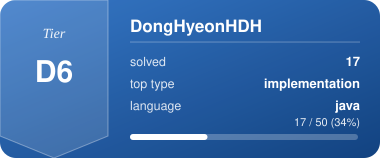

<!--
### Hi there 👋
-->
<!--
**DongHyeonHDH/DongHyeonHDH** is a ✨ _special_ ✨ repository because its `README.md` (this file) appears on your GitHub profile.

Here are some ideas to get you started:

- 🔭 I’m currently working on ...
- 🌱 I’m currently learning ...
- 👯 I’m looking to collaborate on ...
- 🤔 I’m looking for help with ...
- 💬 Ask me about ...
- 📫 How to reach me: ...
- 😄 Pronouns: ...
- ⚡ Fun fact: ...
-->

  

####  :wave: Welcome my github profile !
   
   
📋: possible skills 

   

    
    
 
####  📝: My study log with git
   
  

   

<!-- ALGO-STATS:START -->

### 🧩 Algorithm Problem Solving

| 티어 | 문제 수 |
|---|---|
| D2 | 1 |
| D3 | 2 |
| D4 | 12 |
| D5 | 1 |
| D6 | 1 |

**사용 언어**: `java` 21

**자주 푼 유형 TOP 6**: `implementation` (16), `graph` (6), `bfs` (6), `dfs` (5), `union-find` (3), `dynamic-programming` (2)

최근 푼 문제 (8)

| 날짜 | 문제 | 플랫폼 | 티어 | 유형 |
|---|---|---|---|---|
| 2026-10-27 | [[4007] [Professional] 간담회 참석](https://app.notion.com/p/4007-Professional-40685b4179ee8173a2c8c0d0220de8b5) | SWEA | D4 | graph, dijkstra |
| 2026-10-27 | [[1238] [S/W 문제해결 기본] 10일차 - Contact](https://app.notion.com/p/1238-S-W-10-Contact-40685b4179ee81ce927ee124d4eea4a1) | SWEA | D4 | graph, bfs |
| 2026-10-15 | [[1949] [모의 SW 역량테스트] 등산로 조성](https://app.notion.com/p/1949-SW-3fa85b4179ee81e3b490e588ac2e90dc) | SWEA | - | dfs, implementation |
| 2026-10-14 | [[3307] 최장 증가 부분 수열](https://app.notion.com/p/3307-3f985b4179ee815a8b7aef8852888b2b) | SWEA | D3 | dynamic-programming, implementation |
| 2026-10-14 | [[2477] [모의 SW 역량테스트] 차량 정비소](https://app.notion.com/p/2477-SW-3f985b4179ee81869ff8d6d160e52395) | SWEA | - | implementation |
| 2026-10-13 | [[2115] [모의 SW 역량테스트] 벌꿀채취](https://app.notion.com/p/2115-SW-3f885b4179ee81efb2f5eade8d828b23) | SWEA | - | implementation |
| 2026-10-07 | [[1249] [S/W 문제해결 응용] 4일차 - 보급로](https://app.notion.com/p/1249-S-W-4-3f285b4179ee81029e6ac960af0f54d5) | SWEA | D4 | graph, implementation |
| 2026-10-06 | [[3124] 최소 스패닝 트리](https://app.notion.com/p/3124-3f185b4179ee819ca83cddcf04fb11c7) | SWEA | D4 | graph, greedy, union-find |

_Last synced: 2026-10-28 00:10 UTC · from [Algorithm Note](https://notion.so) via GitHub Actions_

<!-- ALGO-STATS:END -->

